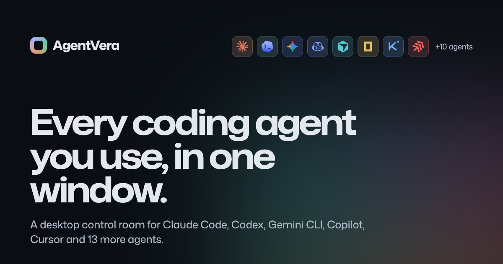
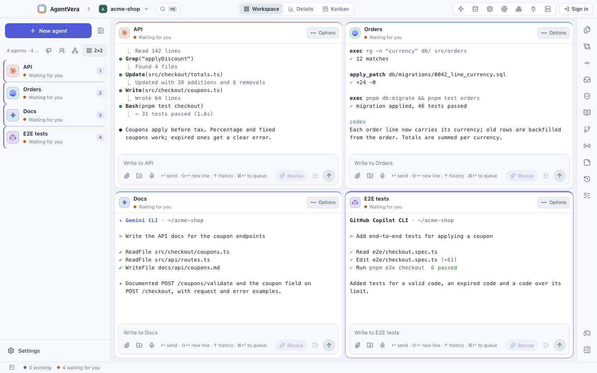
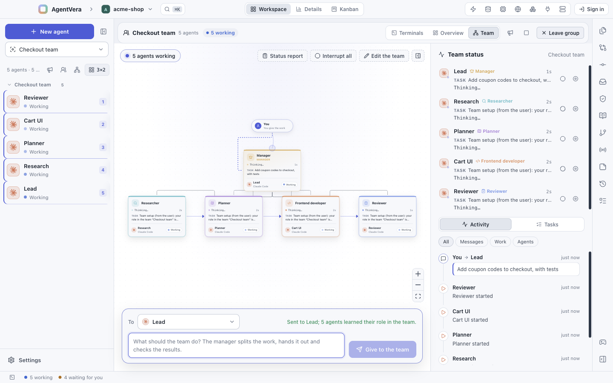
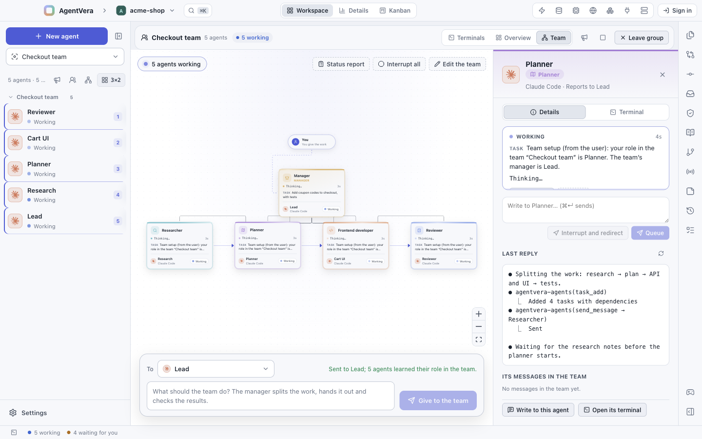

<p align="center">
  <a href="https://agentvera.dev/en/"></a>
</p>

<h1 align="center">AgentVera</h1>

<p align="center">
  <b>Run Claude Code, Codex, Gemini CLI, Copilot and 14 more AI coding agents side by side, on macOS, Windows and Linux.</b><br>
  <a href="https://agentvera.dev/en/">Website</a> ·
  <a href="https://agentvera.dev/en/download/">Download</a> ·
  <a href="https://agentvera.dev/en/features/">Features</a> ·
  <a href="https://agentvera.dev/en/pricing/">Pricing</a> ·
  <a href="https://agentvera.dev/en/blog/">Blog</a> ·
  <a href="#türkçe">Türkçe</a>
</p>

---

AgentVera is a desktop app that runs the coding agents already installed on your computer in real terminals, side by side, per project. Every agent uses its own CLI and its own login (your Claude Pro/Max or ChatGPT plan works as is; no API key needed), and AgentVera adds what is missing between them: layouts, git worktrees, flows, reviews, limits and cost.

This repository is AgentVera's public home: **releases, issues and feature requests**. The app itself is closed source.

**At a glance**

- **Parallel agents on Windows, macOS and Linux.** A native Windows app (x64 installer, no WSL needed), a Mac app and a Linux build. Claude Code, Codex, Gemini CLI, Copilot, Cursor, OpenCode and the other agents each run in their own real terminal, side by side in a grid per project.
- **A git worktree per agent**, so parallel tasks don't overwrite each other's files; you review the diffs and merge.
- **Your own subscriptions.** It starts the `claude`, `codex` and other CLIs you already installed and signed in to.
- **Free plan with unlimited agents.** Pro adds account chains that move an agent to your next account at the usage limit, night shift with auto approval, flows and a kanban board that hands cards to agents. [Plans →](https://agentvera.dev/en/pricing/)
- **Short guides** for each of these are in [docs/](docs/).

<p align="center">
  
</p>

## New in 0.9: themes, six languages and a shared board

- **Themes.** Pick a light or dark color theme (Midnight, Forest, Rose, Amber, Ocean, Violet, Sepia, Mint, Sky, Graphite); terminal colors follow it.
- **Six languages.** The app now speaks German, Spanish, French, Portuguese and Russian, besides English and Turkish.
- **Shareable templates.** Share flows and agent teams as a file or a link, and add ready-made ones from the [community gallery](https://app.agentvera.dev/templates) in one click.
- **Personal and team plans on one email.** Add the same email for both; every account shows its organization and plan.
- **Project board for agents.** Agents post decisions, findings and todos to the project board through the `agentvera-board` MCP server, and a night shift summary card shows what they did while you were away.
- **Lighter and steadier.** Lower memory use, a limit bar that keeps the last reading, and Windows builds tested on every release.

## New in 0.8: a personal assistant, project memory and a browser

- **Personal assistant.** It knows every project, your notes, tasks and past conversations, reads your day, follows your agents and chats in its own window.
- **Project memory.** Agents leave handoff notes with open threads and recall earlier decisions, so the next agent picks up where the last one stopped.
- **A browser you can live in.** History, bookmarks, suggestions and tabs that come back, next to your agents.
- **1,036 skills for every agent** in a catalog of permissively licensed skills, per-agent auto or full-permission mode, and remote MCP servers with a one-time OAuth sign-in for every CLI.

## New in 0.7: agent teams

Build a team from the agents already open in your workspace. Pick a manager, give every agent a role (researcher, planner, developer, reviewer or your own), and draw who hands work to whom. Then write one request: the manager splits it up, the members pass work along, and you watch it happen.

<p align="center">
  
</p>

- **Live team view.** Every card shows the agent's request, current step and time. Answer permission prompts on the card, interrupt an agent and redirect it, or flip a card into its live terminal.
- **Any CLI in any seat.** A Claude Code manager can lead Codex, Gemini and Copilot members; the team only works when you give it work.
- **Agents start teams too.** An agent can split a big task into parallel teams on its own, and night shifts can run per group.

<p align="center">
  
</p>

## Supported agents

Claude Code · Codex · Gemini CLI · GitHub Copilot CLI · Cursor Agent · Antigravity · opencode · Hermes · Qwen Code · Kimi Code · Kiro · Amp · Factory Droid · Goose · Mistral Vibe · Crush · Aider · Cline, plus plain terminals for any other CLI. [One page per agent →](https://agentvera.dev/en/agents/)

## What it does

- **Parallel agents, one window.** Grids from 1×1 to 5×4, agent groups with their own layout and shared notice board, an optional git worktree per agent, and a warning when two agents edit the same file.
- **Work between agents.** [Flows](https://agentvera.dev/en/features/flows/) pass one agent's reply to the next and can send HTTP requests, chat, Telegram and e-mail messages, run commands and write files; a [research → plan → build](https://agentvera.dev/en/features/research-plan-build/) pipeline; [night shift](https://agentvera.dev/en/features/night-shift/) runs queued tasks overnight and opens draft PRs.
- **Quality.** Automatic [code review](https://agentvera.dev/en/features/code-review/) when a turn ends, acceptance checks (Verify), [checkpoints and replay](https://agentvera.dev/en/features/checkpoints-and-replay/), and a project map (a tree-sitter code graph over MCP) so agents find the right files without reading the repo.
- **Every CLI, fully supported.** Sign in to the accounts of every agent CLI without an API key; orchestration, agent-to-agent messages, MCP servers, permission prompts, usage and cost work the same for all of them.
- **Limits and cost.** [Account switching](https://agentvera.dev/en/features/account-switching/) when a 5-hour or weekly limit runs low, context profiles, automatic `/compact`, bundled [RTK](https://github.com/rtk-ai/rtk) that compresses shell output before it reaches the model, and an "Automatic" model that picks Haiku, Sonnet or Opus per task.
- **Skill gallery.** A catalog of 1,036 permissively licensed skills for every agent. Share agent skills with everyone or your organization; every version is security-scanned and public ones are moderator-approved. [Browse skills →](https://app.agentvera.dev/skills)
- **Hand work over easily.** Paste or drop files and screenshots onto an agent; right-click the file tree to create, rename, duplicate, reveal or delete files.
- **From your phone.** Control your agents remotely: projects, git, statistics, voice input, tasks, Docker and limits.
- **Tools agents need.** [MCP manager](https://agentvera.dev/en/features/mcp-manager/), [database manager](https://agentvera.dev/en/features/database-manager/), [SSH/SFTP](https://agentvera.dev/en/features/ssh-and-sftp/) with per-host rules and an encrypted vault, Docker, an API client, a built-in browser with history and bookmarks, and a [runner](https://agentvera.dev/en/runner/) for agents on your own server.
- **Teams.** Organizations, a [team kanban](https://agentvera.dev/en/features/teams-and-kanban/) whose cards go to your running agents, invite-only customer boards and [webhooks](https://agentvera.dev/en/webhooks/).

Your code, conversations and settings stay on your computer; agents talk to their own providers under your accounts.

## Open source: agentvera-board

The shared notice board AgentVera gives every project is also a standalone, MIT-licensed MCP server. Claude Code, Codex, Gemini CLI, opencode, Cursor and other MCP clients share notes, decisions and todos in one file in your project, with or without AgentVera.

```bash
claude mcp add agentvera-board -- npx -y agentvera-board-mcp
```

[Repository](https://github.com/Solviera-Teknoloji/agentvera-board-mcp) · [npm](https://www.npmjs.com/package/agentvera-board-mcp) · Official MCP Registry: `dev.agentvera/board`

## Download

| Platform | Installer |
| --- | --- |
| macOS (Apple silicon) | [AgentVera-mac-arm64.dmg](https://agentvera.dev/downloads/latest/AgentVera-mac-arm64.dmg) |
| macOS (Intel) | [AgentVera-mac-x64.dmg](https://agentvera.dev/downloads/latest/AgentVera-mac-x64.dmg) |
| Windows (x64) | [AgentVera-win-x64.exe](https://agentvera.dev/downloads/latest/AgentVera-win-x64.exe) |
| Linux (x64) | [AppImage](https://agentvera.dev/downloads/latest/AgentVera-linux-x86_64.AppImage) · [.deb](https://agentvera.dev/downloads/latest/AgentVera-linux-amd64.deb) |

On macOS you can also install it with Homebrew:

```bash
brew trust solviera-teknoloji/tap
brew install --cask solviera-teknoloji/tap/agentvera
```

The app updates itself. Core features are free with unlimited agents; Pro and Team plans add flows, the pipeline, night shift, auto approval, account switching, the database manager and team features. [Compare plans →](https://agentvera.dev/en/pricing/)

## Alternatives and comparisons

Side-by-side comparisons, with facts checked on each tool's own site (last checked 3 November 2026):

- Desktop apps for running agents in parallel: [Conductor](https://agentvera.dev/en/alternatives/conductor/), [Orca](https://agentvera.dev/en/alternatives/orca/), [Nimbalyst](https://agentvera.dev/en/alternatives/nimbalyst/), [Paradev (formerly Superset)](https://agentvera.dev/en/alternatives/superset/), [Caprock](https://agentvera.dev/en/alternatives/caprock/), [Swarmterm](https://agentvera.dev/en/alternatives/swarmterm/), [Canopy](https://agentvera.dev/en/alternatives/canopy/)
- Official vendor apps: [Claude desktop app (Code tab)](https://agentvera.dev/en/alternatives/claude-desktop/), [ChatGPT desktop app (Codex)](https://agentvera.dev/en/alternatives/codex-app/), [VS Code Agents window](https://agentvera.dev/en/alternatives/vscode-agents/)
- Terminals and boards: [Claude Squad](https://agentvera.dev/en/alternatives/claude-squad/), [Vibe Kanban](https://agentvera.dev/en/alternatives/vibe-kanban/), [Warp](https://agentvera.dev/en/alternatives/warp/), [tmux](https://agentvera.dev/en/alternatives/tmux/), [Zed](https://agentvera.dev/en/alternatives/zed/)

Guides: [best tools to run AI coding agents in parallel](https://agentvera.dev/en/blog/best-tools-parallel-ai-coding-agents/) · [Claude Code account switchers compared](https://agentvera.dev/en/blog/claude-code-account-switchers/) · [kanban boards for AI coding agents](https://agentvera.dev/en/blog/kanban-boards-for-ai-coding-agents/) · [Vibe Kanban alternatives](https://agentvera.dev/en/blog/vibe-kanban-alternatives/) · [all comparisons](https://agentvera.dev/en/alternatives/)

Docs in this repository: [short answer-first pages](docs/) on account switching, running agents side by side, team kanban, the MCP manager and night shift.

## Changelog

What changed in each release: [CHANGELOG.md](CHANGELOG.md).

## Feedback

- **Bug or crash:** [open an issue](../../issues/new?template=bug.yml)
- **Idea or missing agent:** [request a feature](../../issues/new?template=feature.yml)

---

## Türkçe

**AgentVera; Claude Code, Codex, Gemini CLI, Copilot ve 14 kodlama ajanını daha macOS, Windows ve Linux'ta yan yana çalıştıran bir masaüstü uygulaması.** Her ajan bilgisayarındaki kendi CLI'ıyla ve kendi hesabınla, gerçek bir terminalde çalışır; Claude ya da ChatGPT aboneliğin olduğu gibi kullanılır, API anahtarı gerekmez. AgentVera aralarındaki işi yönetir: düzenler, git worktree'ler, akışlar, kod incelemesi, limitler ve token tasarrufu.

**0.7 ile ajan ekipleri geldi:** çalışma alanındaki ajanlardan bir yönetici ve ekip kurarsın, her ajana rol verir, kimin kime iş devredeceğini çizersin. Tek bir istek yazarsın; yönetici işi böler, ekip işi birbirine devreder, sen de ekip görünümünden her ajanın ne yaptığını, hangi adımda olduğunu izler, izinleri kartın üstünden verirsin. **0.8 ile kişisel asistan geldi:** tüm projelerini, notlarını, görevlerini ve geçmiş konuşmalarını bilir, gününü okur, ajanlarını takip eder. Ajanlar proje hafızasına devir notları bırakır; yerleşik tarayıcı geçmişi, yer imlerini ve sekmeleri hatırlar; her ajan için 1.036 skill'lik bir katalog var. Ayrıca her CLI için oturum açarak hesap ekleme, akışlarda HTTP/Telegram/e-posta adımları, dosya ağacında sağ tık menüsü ve telefondan uzaktan kontrol var. **0.9 ile temalar ve yeni diller geldi:** açık ve koyu renk temaları; Almanca, İspanyolca, Fransızca, Portekizce ve Rusça arayüz; akışları ve ekipleri şablon olarak paylaşma ve topluluk galerisi; aynı e-postayla kişisel ve ekip planı; ajanların karar ve bulgularını yazdığı proje panosu ve gece mesaisi özeti.

**Açık kaynak:** AgentVera'nın her projeye verdiği ortak not panosu, MIT lisanslı bağımsız bir MCP sunucusu olarak da var. Claude Code, Codex, Gemini CLI ve diğer ajanlar projedeki tek bir dosyada not, karar ve görev paylaşır: [agentvera-board](https://github.com/Solviera-Teknoloji/agentvera-board-mcp).

[Türkçe site](https://agentvera.dev/) · [İndir](https://agentvera.dev/indir/) · [Özellikler](https://agentvera.dev/ozellikler/) · [Fiyatlar](https://agentvera.dev/fiyatlar/) · [Alternatifler](https://agentvera.dev/alternatifler/)

Hata ve önerilerini bu depodaki Issues bölümüne yazabilirsin.

---

<sub>AgentVera is built by <a href="https://solviera.com.tr">Solviera Teknoloji</a>. Claude, Codex, Gemini and other names are trademarks of their owners; AgentVera is not affiliated with them.</sub>
